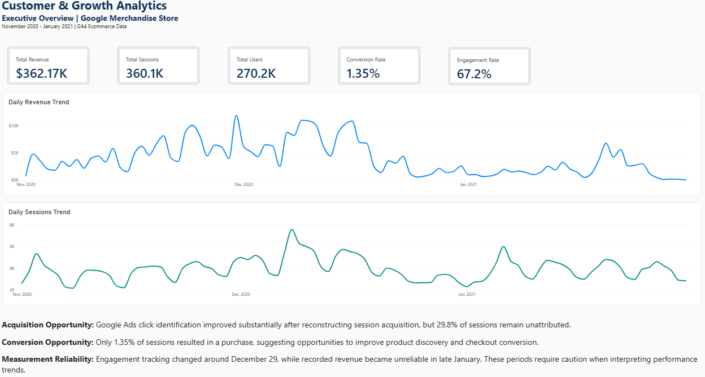
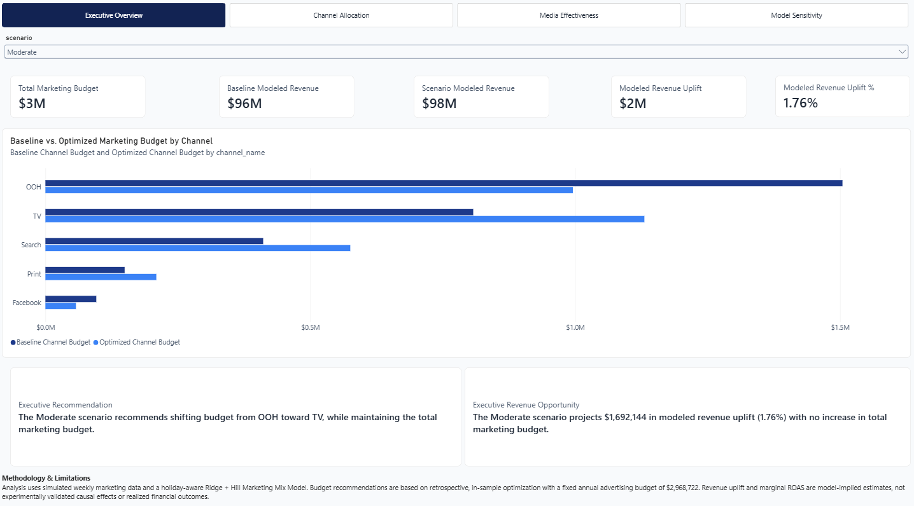

# Marketing Analytics & Decision Science Portfolio

**From Customer Behavior to Marketing Investment Optimization**

A portfolio of two end-to-end marketing analytics projects demonstrating how data engineering, statistical modeling, machine learning, and business intelligence can transform marketing data into actionable decision support.

The projects cover two complementary dimensions of marketing analytics:

- **Customer & Growth Analytics:** Understanding how customers are acquired, engage, convert, return, and generate revenue.
- **Marketing Decision Science:** Measuring marketing effectiveness, estimating nonlinear advertising response, and optimizing marketing investment.

Each project includes reproducible analytical workflows, documented business findings, and an interactive Power BI dashboard.

The projects use separate public and simulated datasets and should not be interpreted as one integrated commercial analysis.

---

## Featured Projects

### Project A — Customer & Growth Analytics

**Google Analytics 4 | BigQuery | SQL | Python | Power BI**

[Explore Project A](project_a_customer_growth/README.md)

An end-to-end ecommerce analytics project using the Google Merchandise Store GA4 public dataset.

Reconstructed session-level customer activity from raw event data, improved acquisition classification, analyzed conversion behavior, and evaluated customer retention and observed customer value.

**Project Highlights**

| Metric | Result |
|---|---:|
| Sessions Analyzed | 360,129 |
| Unique Users | 270,154 |
| Recorded Revenue | $362,165 |
| Session Conversion Rate | 1.35% |
| Canonical Engagement Rate | 67.2% |
| 30-Day Customer Return Rate | 11.8% |

**Capabilities Demonstrated**

- GA4 event-level data engineering and session reconstruction
- Acquisition source reconstruction and Google Ads click identification
- Marketing channel performance analysis
- Ecommerce conversion funnel measurement
- Customer segmentation and behavioral analysis
- Cohort and fixed-window retention analysis
- Standardized 30-day customer value
- Data-quality investigation and metric governance
- Interactive Power BI reporting

**Power BI Dashboard**



[View all three dashboard pages](project_a_customer_growth/README.md#power-bi-dashboard)

[Read Executive Summary](project_a_customer_growth/reports/executive_summary.md)

---

### Project B — Marketing Investment Optimization

**Marketing Mix Modeling | Machine Learning | Bayesian Optimization | Power BI**

[Explore Project B](project_b_marketing_decision_science/README.md)

An end-to-end marketing decision science project using Meta Robyn's simulated weekly marketing dataset.

Developed and compared statistical and machine learning models, estimated advertising carryover and nonlinear media response, and evaluated constrained marketing budget allocation strategies.

**Project Highlights**

| Metric | Result |
|---|---:|
| Marketing Channels | 5 |
| Weekly Observations | 208 |
| Model Families Compared | 4 |
| Best Mean CV NRMSE | 15.30% |
| Annual Marketing Budget | $2.97M |
| Modeled Revenue Uplift | $0.96M–$2.25M |
| Budget Scenarios | 3 |

*Revenue uplift represents retrospective, model-implied estimates, not experimentally validated incremental revenue.*

**Capabilities Demonstrated**

- Marketing Mix Modeling (MMM)
- Geometric adstock and Hill saturation
- Ridge regression and nonlinear machine learning
- XGBoost, Generalized Additive Models, and Explainable Boosting Machines
- Bayesian hyperparameter optimization using Optuna
- Expanding-window time-series cross-validation
- Marketing attribution and sensitivity analysis
- Marginal ROAS and advertising response curves
- Constrained budget optimization using SciPy
- Interactive Power BI scenario analysis

**Power BI Dashboard**



[View all four dashboard pages](project_b_marketing_decision_science/README.md#power-bi-dashboard-gallery)

[Read Executive Summary](project_b_marketing_decision_science/reports/executive_summary.md)

---

## End-to-End Marketing Analytics Framework

Together, these projects demonstrate two complementary analytical workflows.

| Customer & Growth Analytics | Marketing Decision Science |
|---|---|
| Customer Acquisition | Marketing Investment |
| Traffic & Engagement | Marketing Mix Modeling |
| Ecommerce Conversion | Channel Contribution |
| Customer Segmentation | Advertising Carryover & Saturation |
| Cohort Retention | Marginal ROAS |
| Observed Customer Value | Budget Optimization |
| Customer Growth Recommendations | Investment Scenario Planning |

Project A focuses on observed customer behavior and ecommerce performance.

Project B focuses on modeled marketing effectiveness and investment decisions.

Together, they illustrate how marketing analytics can support both customer growth measurement and strategic resource allocation.

---

## Technical Skills

| Area | Technologies & Methods |
|---|---|
| Programming | Python, SQL |
| Data Engineering | Google BigQuery, GA4 event processing, ETL |
| Data Analysis | pandas, NumPy, SciPy |
| Statistical Modeling | Ridge Regression, GAM, time-series analysis |
| Machine Learning | XGBoost, Explainable Boosting Machines |
| Model Optimization | Optuna, Bayesian hyperparameter optimization |
| Marketing Science | MMM, adstock, saturation, attribution, marginal ROAS |
| Decision Science | Constrained optimization, scenario analysis, sensitivity testing |
| Business Intelligence | Power BI, DAX, interactive dashboards |
| Development | Git, GitHub, VS Code |

---

## Repository Structure

```text
marketing-analytics-portfolio/
│
├── README.md
├── requirements.txt
│
├── project_a_customer_growth/
│   ├── README.md
│   ├── Project_A_Customer_Growth_Analytics.pbix
│   ├── assets/
│   ├── reports/
│   ├── sql/
│   ├── src/
│   └── outputs/
│
└── project_b_marketing_decision_science/
    ├── README.md
    ├── requirements.txt
    ├── Project_B_Marketing_Decision_Science.pbix
    ├── assets/
    ├── data/
    ├── reports/
    ├── src/
    └── outputs/
```

Each project includes its own methodology, reproducibility guidance, analytical outputs, and Power BI reporting assets.

---

## Analytical Principles

Both projects emphasize:

- **Reproducibility:** Version-controlled code, documented transformations, and saved reporting outputs.
- **Measurement Integrity:** Explicit metric definitions and transparent handling of incomplete data.
- **Model Validation:** Appropriate evaluation methods and documented limitations.
- **Business Relevance:** Analytical findings connected to practical marketing decisions.
- **Responsible Interpretation:** Distinguishing observed relationships and modeled estimates from experimentally validated causal effects.

---

## Portfolio Summary

This portfolio demonstrates capabilities across the marketing analytics lifecycle, from raw digital event data and customer measurement to advanced marketing modeling and constrained investment optimization.

The central objective is to connect technical analysis with business decisions through interpretable methodologies, defensible measurement, and accessible executive reporting.